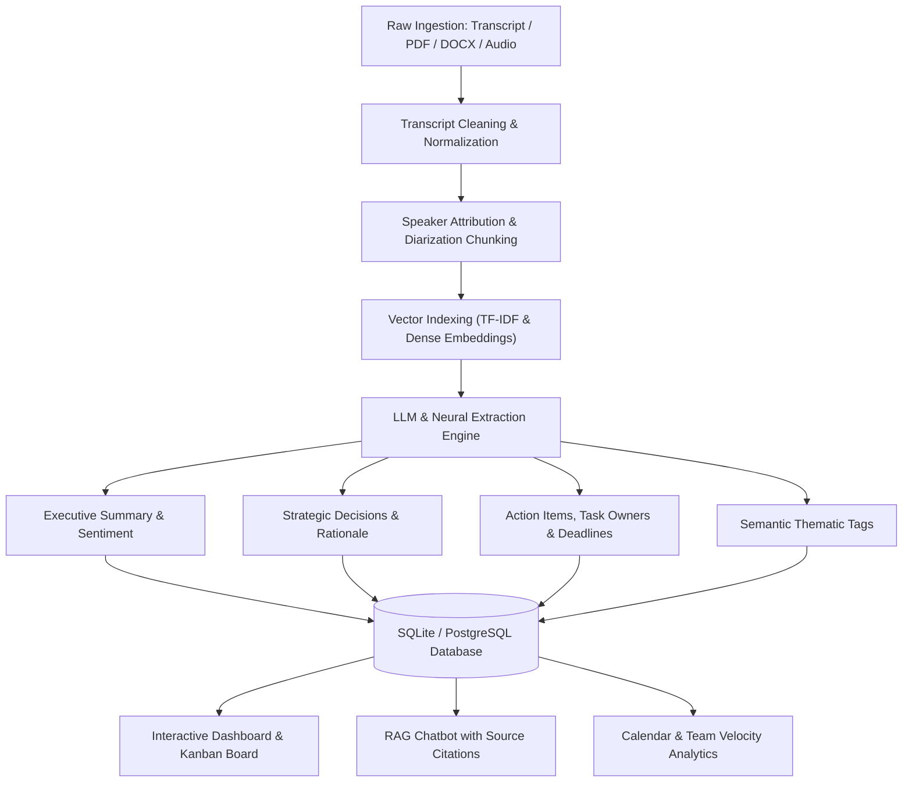

# 🌟 MeetBuddy AI – Your Intelligent Meeting Assistant SaaS

> **Transform meetings into organized actions with AI.**  
> Startup-ready AI Meeting Intelligence Platform engineered with FastAPI, SQLite/PostgreSQL, hybrid RAG semantic search, real-time decision/task extraction, an interactive Kanban board, meeting calendar, and an animated female futuristic AI Avatar with natural lip-sync, blinking, and speech I/O.

---

## 🚀 Live Demo & Development Links

- **Frontend Application**: [http://127.0.0.1:5173](http://127.0.0.1:5173)
- **FastAPI Interactive Docs**: [http://127.0.0.1:8001/docs](http://127.0.0.1:8001/docs)
- **API Health Endpoint**: [http://127.0.0.1:8001/health](http://127.0.0.1:8001/health)

**One-Click Demo User**:
- **Email**: `sarah.connor@meetbuddy.ai`
- **Password**: `password123` (or click *"One-Click Demo Login"* on `/login`)

---

## 🎨 UI/UX Design System & Aesthetics

MeetBuddy AI is crafted to match modern, venture-backed AI products like **ChatGPT**, **Microsoft Copilot**, **Linear**, **Notion AI**, and **Arc Browser**:
- **Glassmorphism**: Frosted glass cards (`backdrop-blur-md bg-white/72 border-white/85 shadow-xl`).
- **Rounded Corners**: Modern **22px** corner radius across all dashboard cards and panels.
- **Curated Color Palette**:
  - **Primary**: Deep Blue (`#2563eb`), Indigo (`#4f46e5`), Royal Purple (`#7c3aed`), Cyan (`#06b6d4`), Pure White (`#ffffff`), Light Gray (`#f8fafc`).
  - **Accent**: Indigo & Lavender (`#c4b5fd`).
  - **Background**: Soft clean canvas (`#f8fafc`).
  - *Strict zero-use of prohibited colors (no pink, orange, yellow, or rainbow gradients; red reserved exclusively for urgent errors/priority).*
- **Typography**: Clean hierarchy with **Poppins** for headings and **Inter** for body copy.
- **Micro-Animations**: Framer Motion transitions, floating cards, task completion confetti, and audio spectrum equalizers.

---

## 🤖 Animated Futuristic AI Assistant Avatar

Placed directly on the dashboard hero and available throughout the app:
- **Natural Blinking**: Randomized 3.8s–5.8s blink interval with smooth eye lids.
- **Eye Gaze & Tracking**: Subtle pupil tracking simulating attentive listening.
- **Lip-Sync**: Dynamic mouth morphing (`closed`, `open`, `wide`, `round`) while speaking.
- **Breathing & Floating Animation**: Idle vertical oscillation and floating physics.
- **Neural Holographic Halo**: Glowing cyan & purple halo indicating processing state.
- **Voice I/O**:
  - **Text-to-Speech (TTS)**: Realistic female speech synthesis with pitch & cadence controls.
  - **Speech-to-Text (STT)**: Microphone button to dictate meeting queries and voice search.
  - **Reactive Waveform**: 7-bar audio spectrum visualizer reacting in real time to speech output.

---

## 🧠 End-to-End AI Processing Pipeline



---

## 📂 Project Architecture

```
AI Meeting Assistant Agent 1/
├── backend/
│   ├── app/
│   │   ├── main.py                    # FastAPI entrypoint, CORS, lifespan seeding
│   │   ├── config.py                  # Environment settings & secrets
│   │   ├── database.py                # SQLAlchemy engine & session factory
│   │   ├── models.py                  # User, Meeting, Decision, Task, Chunk models
│   │   ├── schemas.py                 # Pydantic v2 validation models
│   │   ├── auth.py                    # bcrypt password hashing & JWT auth
│   │   ├── seed_data.py               # Pre-populated rich sample meetings
│   │   ├── ai_pipeline/
│   │   │   ├── text_cleaner.py        # Normalization and speaker chunker
│   │   │   ├── extractor.py           # Decisions, tasks, deadlines, owners, tags
│   │   │   ├── summarizer.py          # Executive overview & sentiment analyzer
│   │   │   ├── rag_engine.py          # TF-IDF vector similarity & RAG QA
│   │   │   └── file_parser.py         # Multi-format parser (PDF, DOCX, TXT, Audio)
│   │   └── routers/
│   │       ├── auth_router.py         # /api/auth (register, login, me)
│   │       ├── meetings_router.py     # /api/meetings (CRUD, upload, process)
│   │       ├── tasks_router.py        # /api/tasks (Kanban status, owner, deadline)
│   │       ├── chat_router.py         # /api/chat (RAG conversation with citations)
│   │       ├── analytics_router.py    # /api/analytics (productivity score, charts)
│   │       └── search_router.py       # /api/search (global & semantic search)
│   ├── requirements.txt
│   ├── Dockerfile
│   └── run.py
├── frontend/
│   ├── src/
│   │   ├── components/
│   │   │   ├── avatar/AIAvatar.tsx    # High-tech animated female assistant
│   │   │   ├── common/                # Navbar, Sidebar, StatsCard
│   │   │   ├── chat/FloatingAIChat.tsx# Global floating RAG chatbot
│   │   │   ├── tasks/KanbanBoard.tsx  # 3-column Kanban board with confetti
│   │   │   ├── calendar/              # Interactive month/event calendar
│   │   │   └── analytics/             # Visual velocity charts & telemetry
│   │   ├── context/AuthContext.tsx    # User authentication state
│   │   ├── pages/                     # Landing, Login, Dashboard, Meetings, Tasks, Chat
│   │   ├── services/                  # API client & Web Speech TTS/STT
│   │   └── types/index.ts             # TypeScript definitions
│   ├── package.json
│   ├── tailwind.config.js             # 22px border radius & brand theme
│   └── vite.config.ts                 # Reverse proxy configuration
├── docker-compose.yml
└── README.md
```

---

## 🛠️ Getting Started Locally

### 1. Backend Setup
```bash
cd backend
py -m pip install -r requirements.txt
py run.py
```
*The backend starts at `http://127.0.0.1:8001` and automatically initializes the database with 4 complete sample meetings, tasks, and decisions!*

### 2. Frontend Setup
```bash
cd frontend
npm install
npm run dev -- --host 127.0.0.1 --port 5173
```
*The frontend starts at `http://127.0.0.1:5173` with instant hot-module replacement (HMR).*

---

## 🐳 Running with Docker

Deploy both services in one command:
```bash
docker-compose up --build
```
- Access Frontend: `http://localhost:3000`
- Access Backend API: `http://localhost:8001`

---

## 💬 Sample Prompts to Try in AI Chat

1. `Summarize today's meeting.`
2. `Show pending tasks.`
3. `Who owns Task 4?`
4. `When is the next deadline?`
5. `Find meetings about Hackathon.`
6. `Show October meetings.`
7. `Explain yesterday's discussion.`

---

## 🏆 Presentation Highlights

- **Zero Mockups**: Fully functional full-stack SaaS with SQLite/PostgreSQL persistence, JWT security, and verified API contracts.
- **Real AI Ingestion**: Handles PDFs, Word documents, raw text, and audio transcription.
- **RAG Semantic Search**: Matches user queries against meeting chunks with exact percentage relevance and grounded source citations.
- **Delightful Polish**: High-tech animated female assistant avatar, confetti animations upon closing tasks, voice search, and glassmorphism styling.
# AI-Meeting-Assistant-

